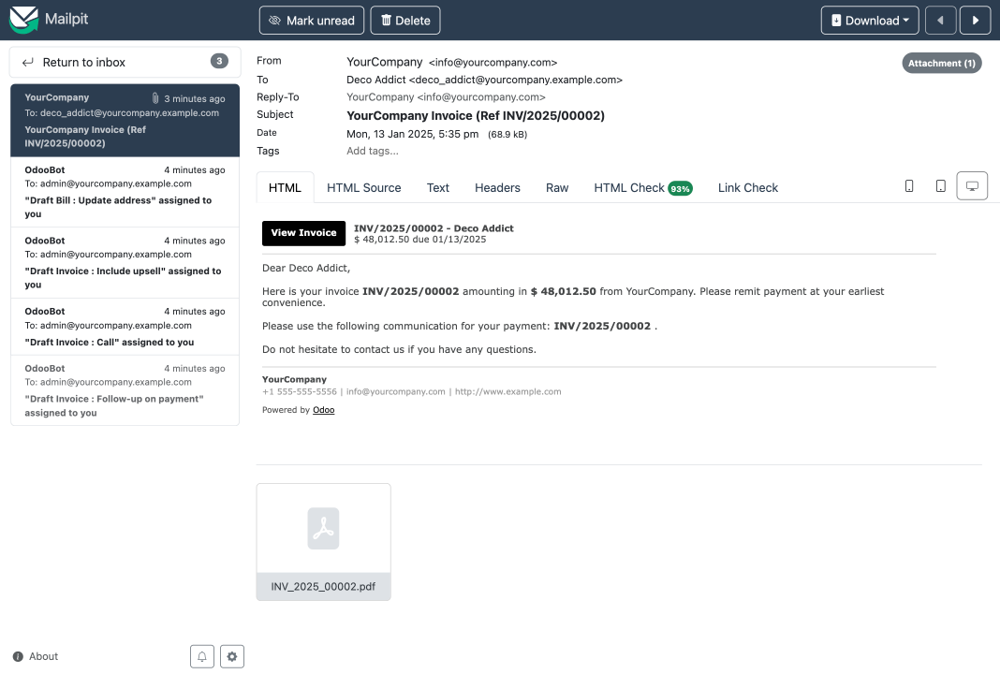

# 🧰 Odoo Toolkit

This toolkit contains a few useful tools for Odoo development. The tools are primarily aimed at Odoo employees.

The quickest way to get started is to install the tools using either [pipx](https://pipx.pypa.io/stable/), [uv](https://docs.astral.sh/uv/) or any other package manager to install them in an isolated environment.

You can install the package from [PyPI](https://pypi.org/project/odoo-toolkit/):
```console
$ pipx install odoo-toolkit
```
```console
$ uv tool install odoo-toolkit
```
or from the [GitHub repository](https://github.com/dylankiss/odoo-toolkit) directly:
```console
$ pipx install --force git+https://github.com/dylankiss/odoo-toolkit.git
```
```console
$ uv tool install --force git+https://github.com/dylankiss/odoo-toolkit.git
```

> [!TIP]
> You can run any command with the `--help` option to find out all options you can use.

> [!TIP]
> Anywhere you can provide modules as arguments or options, you can also use [glob patterns](https://docs.python.org/3/library/fnmatch.html) to match multiple similar ones.

**Usage**:

```console
$ otk [OPTIONS] COMMAND [ARGS]...
```

**Options**:

* `--install-completion`: Install completion for the current shell.
* `--show-completion`: Show completion for the current shell, to copy it or customize the installation.
* `--version`: Show the version and exit.
* `--help`: Show this message and exit.


## Table of Contents

### [Odoo Translation Files (`otk po`)](#odoo-translation-files-otk-po-1)

| Command                           | Purpose                                                                             |
| --------------------------------- | ----------------------------------------------------------------------------------- |
| [`otk po export`](#otk-po-export) | Export Odoo translation files (.pot) to each module's i18n folder.                  |
| [`otk po create`](#otk-po-create) | Create Odoo translation files (.po) according to their .pot files.                  |
| [`otk po update`](#otk-po-update) | Update Odoo translation files (.po) according to a new version of their .pot files. |

### [Odoo Development Server (`otk dev`)](#odoo-development-server-otk-dev-1)

| Command                                 | Purpose                                                                              |
| --------------------------------------- | ------------------------------------------------------------------------------------ |
| [`otk dev start`](#otk-dev-start)       | Start an Odoo Development Server using Docker and launch a terminal session into it. |
| [`otk dev start-db`](#otk-dev-start-db) | Start a standalone PostgreSQL container for your Odoo databases.                     |
| [`otk dev stop`](#otk-dev-stop)         | Stop and delete all running containers of the Odoo Development Server.               |

### [Odoo Weblate (`otk wl`)](#odoo-weblate-otk-wl-1)

| Command                                                 | Purpose                                                                                     |
| ------------------------------------------------------- | ------------------------------------------------------------------------------------------- |
| [`otk wl autotranslate`](#otk-wl-autotranslate)         | Autotranslate translations for components in a Weblate project.                             |
| [`otk wl autotranslate-from`](#otk-wl-autotranslate-from) | Autotranslate components in a Weblate project from equally named components in another project. |
| [`otk wl config`](#otk-wl-config)                       | Update modules in the Weblate config file.                                                  |
| [`otk wl config-odoo`](#otk-wl-config-odoo)             | Generate the standard Odoo Weblate config profile for a version.                            |
| [`otk wl copy`](#otk-wl-copy)                           | Copy translations between languages, components, and/or projects.                           |
| [`otk wl download`](#otk-wl-download)                   | Download specific PO files from Weblate.                                                    |
| [`otk wl update-components`](#otk-wl-update-components) | Update Weblate components based on the `.weblate.json` configuration in the current folder. |
| [`otk wl update-teams`](#otk-wl-update-teams)           | Update Weblate teams permissions.                                                           |
| [`otk wl upload`](#otk-wl-upload)                       | Upload specific PO files to Weblate.                                                        |

### [Odoo Multiverse (`otk mv`)](#odoo-multiverse-otk-mv-1)

| Command                           | Purpose                                                                                        |
| --------------------------------- | ---------------------------------------------------------------------------------------------- |
| [`otk mv setup`](#otk-mv-setup)   | Set up an Odoo Multiverse environment, having different versions checked out at the same time. |
| [`otk mv reset`](#otk-mv-reset)   | Reset the repositories inside an Odoo Multiverse version directory.                            |
| [`otk mv switch`](#otk-mv-switch) | Switch branches inside an Odoo Multiverse version directory.                                   |
| [`otk mv link`](#otk-mv-link)     | Link a shared or pinned repository into the current Odoo Multiverse version directory.            |
| [`otk mv unlink`](#otk-mv-unlink) | Unlink a shared or pinned repository from the current Odoo Multiverse version directory.          |
| [`otk mv cleanup`](#otk-mv-cleanup) | Remove the branches the Odoo Multiverse repositories don't need, and reclaim their disk space. |


## Odoo Translation Files (`otk po`)

**Work with Odoo Translation Files (`.po` and `.pot` files).**

The following commands allow you to export `.pot` files for Odoo modules, create or update `.po` files according to their (updated) `.pot` files, or merge multiple `.po` files into one.


## `otk po export`

**Export Odoo translation files (`.pot`) to each module's `i18n` folder.**

This command can autonomously start separate Odoo servers to export translatable terms for one or more modules. A separate server will be started for Community, Community (Localizations), Enterprise, Enterprise (Localizations), and custom modules with only the modules installed to be exported in that version, and all (indirect) dependent modules that might contribute terms to the modules to be exported.

You can also export terms from your own running server using the `--own-server` option and optionally passing the correct arguments to reach your Odoo server.

> [!NOTE]
> Without any options specified, the command is supposed to run from within the parent directory where your `odoo` and `enterprise` repositories are checked out with these names. Your database is supposed to run on `localhost` using port `5432`, accessible without a password using your current user.
>
> Of course, all of this can be tweaked with the available options. 😉

### Usage

```console
$ otk po export [OPTIONS] MODULES...
```
e.g.

```console
$ otk po export --db-username odoo --db-password odoo "account_*" mrp sale
```

### Arguments

* `MODULES...`: Export .pot files for these Odoo modules (supports glob patterns), or either `all`, `community`, or `enterprise`.  **[required]**

### Options

* `-x, --exclude TEXT`: Exclude these modules from being installed and exported, or `default`.
* `-f, --path-filter PATH`: Only include modules within these paths.
* `--help`: Show this message and exit.

**Odoo Server Options**:

* `--start-server / --own-server`: Start an Odoo server automatically or connect to your own server.  [default: `start-server`]
* `--keep-db`: Keep the database after exporting the `.pot` files.
* `--full-install`: Install every available Odoo module.
* `--quick-install`: Install only the modules to export.
* `-c, --com-path PATH`: Specify the path to your Odoo Community repository.  [default: `odoo`]
* `-e, --ent-path PATH`: Specify the path to your Odoo Enterprise repository.  [default: `enterprise`]
* `-a, --addons-path PATH`: Specify extra addons paths if your modules are not in Community or Enterprise.
* `-u, --username TEXT`: Specify the username to log in to Odoo.  [default: `admin`]
* `-p, --password TEXT`: Specify the password to log in to Odoo.  [default: `admin`]
* `--host TEXT`: Specify the hostname of your Odoo server.  [default: `localhost`]
* `--port INTEGER`: Specify the port of your Odoo server.  [default: `8069`, or the first free one after that when `--start-server`]

**Database Options**:

* `-d, --database TEXT`: Specify the PostgreSQL database name used by Odoo.  [default: `export_pot_db_{port}`]
* `--db-host TEXT`: Specify the PostgreSQL server's hostname.  [default: `localhost`]
* `--db-port INTEGER`: Specify the PostgreSQL server's port.  [default: `5432`]
* `--db-username TEXT`: Specify the PostgreSQL server's username.
* `--db-password TEXT`: Specify the PostgreSQL user's password.

## `otk po create`

**Create Odoo translation files (`.po`) according to their `.pot` files.**

> [!NOTE]
> Uses the gettext `msginit` command if available.

This command will provide you with a clean `.po` file per language you specified for the given modules. It basically copies all entries from the `.pot` file in the module and completes the metadata with the right language information. All generated `.po` files will be saved in the respective modules' `i18n` directories.

> [!NOTE]
> Without any options specified, the command is supposed to run from within the parent directory where your `odoo` and `enterprise` repositories are checked out with these names.

### Usage

```console
$ otk po create [OPTIONS] MODULES...
```
e.g.

```console
$ otk po create -l nl -l fr -l de l10n_be l10n_be_reports
```

### Arguments

* `MODULES...`: Create .po files for these Odoo modules, or either `all`, `community`, or `enterprise`.  **[required]**

### Options

* `-l, --languages TEXT`: Create .po files for these language codes, or `all`.  **[required]**
* `-x, --exclude TEXT`: Exclude these modules from being updated.
* `-f, --path-filter PATH`: Only include modules within these paths.
* `-c, --com-path PATH`: Specify the path to your Odoo Community repository.  [default: `odoo`]
* `-e, --ent-path PATH`: Specify the path to your Odoo Enterprise repository.  [default: `enterprise`]
* `-a, --addons-path PATH`: Specify extra addons paths if your modules are not in Community or Enterprise.
* `--help`: Show this message and exit.


## `otk po update`

**Update Odoo translation files (`.po`) according to a new version of their `.pot` files.**

> [!NOTE]
> Uses the gettext `msgmerge` and `msgattrib` commands if available.

This command will update the `.po` files for the provided modules according to a new `.pot` file you might have exported in their `i18n` directory.

> [!NOTE]
> Without any options specified, the command is supposed to run from within the parent directory where your `odoo` and `enterprise` repositories are checked out with these names.

### Usage

```console
$ otk po update [OPTIONS] MODULES...
```
e.g.
```console
$ otk po update -l nl -l fr account account_accountant
```

### Arguments

* `MODULES...`: Update .po files for these Odoo modules, or either `all`, `community`, or `enterprise`.  **[required]**

### Options

* `-l, --languages TEXT`: Update .po files for these language codes, or `all`.  [default: `all`]
* `-x, --exclude TEXT`: Exclude these modules from being updated.
* `-f, --path-filter PATH`: Only include modules within these paths.
* `-c, --com-path PATH`: Specify the path to your Odoo Community repository.  [default: `odoo`]
* `-e, --ent-path PATH`: Specify the path to your Odoo Enterprise repository.  [default: `enterprise`]
* `-a, --addons-path PATH`: Specify extra addons paths if your modules are not in Community or Enterprise.
* `--help`: Show this message and exit.


## Odoo Development Server (`otk dev`)

**Run an Odoo Development Server using Docker.**

The following commands allow you to automatically start and stop a fully configured Docker container to run your Odoo server(s) during development.

> [!IMPORTANT]
> These tools require [Docker Desktop](https://www.docker.com/products/docker-desktop/) to be installed on your system.
> For Mac and Windows there are convenient installers.
> For Linux there are specific instructions for installation. Below you can find the instructions for Debian-based amd64 systems.

```console
# Prerequisite
sudo apt install gnome-terminal

# Add official Docker GPG key
sudo apt-get update
sudo apt-get install ca-certificates curl
sudo install -m 0755 -d /etc/apt/keyrings
sudo curl -fsSL https://download.docker.com/linux/debian/gpg -o /etc/apt/keyrings/docker.asc
sudo chmod a+r /etc/apt/keyrings/docker.asc

# Add the repository to Apt sources
echo \
  "deb [arch=$(dpkg --print-architecture) signed-by=/etc/apt/keyrings/docker.asc] https://download.docker.com/linux/debian \
  $(. /etc/os-release && echo "$VERSION_CODENAME") stable" | \
  sudo tee /etc/apt/sources.list.d/docker.list > /dev/null
sudo apt-get update

# Download Docker Desktop package and install
curl -SL https://desktop.docker.com/linux/main/amd64/docker-desktop-amd64.deb -o docker-desktop-amd64.deb
sudo apt-get install ./docker-desktop-amd64.deb
rm docker-desktop-amd64.deb

# (Optional) Auto-start Docker Desktop on startup
systemctl --user enable docker-desktop
```

The Docker container is configured to resemble Odoo's CI or production servers and thus tries to eliminate discrepancies between your local system and the CI or production server.


## `otk dev start`

**Start an Odoo Development Server using Docker and launch a terminal session into it.**

This command will start both PostgreSQL, Mailhog, and pgAdmin containers, and an Odoo container containing your source code, located on your machine at the location specified by `-w`. Your specified workspace will be sourced in the container at the location `/code` and allows live code updates during local development.

The container started will be tailored to the version you want to run in it. The containers are based on our Runbot containers, with some added tools.

When you're done with the container, you can exit the session by running the `exit` command. At this point, the container will still be running and you can start a new session using the same `otk dev start` command.

### Port Mapping

Every container exposes a different port for the Odoo server, starting at `8070` for Odoo 17.0. The port used is displayed on the command line in your container. You can access the server on your local machine using `localhost:<port>`. When using the `o-bin-*` commands to run your server, the port is automatically set. When not using the `o-bin-*` command, you need to use the `--http-port` option to run on the right port.

This allows you to run multiple Odoo servers (one per container), all accessible on your local machine. If you also have a local server running on default port `8069`, it will not clash with the Docker ports.

### PostgreSQL Container

The command starts a separate [PostgreSQL](https://www.postgresql.org/) container that you can access from your host machine at `localhost:5432` by default, using `odoo` as username and no password. Inside your other Docker containers, the hostname of this server is `postgres`. It is exposed to the Odoo containers via a socket as well in the `/var/run/postgresql` directory.

### Mailpit Container

The command starts a [Mailpit](https://mailpit.axllent.org/) container that is used for intercepting outgoing email messages from any of your Odoo instances. The application can be accessed from your local machine by going to http://localhost:8025. It allows you to view any sent email with its attachments and all possible related information. You can download them in `.eml` format, `.html` format, and even `.png` format as a screenshot.



The container uses a persistent storage (on the `odoo-mailpit-storage` volume) that saves up to 5000 messages. The oldest messages will be deleted after that. When the volume is deleted, all messages will be gone as well.

### pgAdmin Container

The command starts a [pgAdmin](https://www.pgadmin.org/) container that you can use to inspect and interact with the databases in the PostgreSQL container. The application can be accessed from your local machine by going to http://localhost:5050. When you connect to the PostgreSQL server for the first time, pgAdmin will ask for a password. You can just leave this empty.

### Aliases

The container contains some helpful aliases that you can use to run and debug Odoo from your workspace (*either `/code` or `/code/<branch>` if you're using the multiverse setup*). They contain some default configuration and set very high time limits by default (useful for debugging). You can check them in [`.bash_aliases`](odoo_toolkit/docker/.bash_aliases).

**Running Odoo** (from within the workspace folder)
- `o-bin` can be used instead of `odoo/odoo-bin` with the same arguments.

**Running an Odoo shell** (from within the workspace folder)
- `o-bin-sh` can be used instead of `odoo/odoo-bin shell` with the same arguments.

**Upgrading Odoo** (from within the workspace folder)
- `o-bin-up` can be used instead of `odoo/odoo-bin --upgrade-path=...` with the same arguments.

**Debugging Odoo** (from within the workspace folder)
- `o-bin-deb` can be used instead of `odoo/odoo-bin` with the same arguments, starts a debug session using [`debugpy`](https://github.com/microsoft/debugpy) and waits for your local debugger to connect to it before starting.

**Debugging Odoo Upgrade** (from within the workspace folder)
- `o-bin-deb-up` can be used instead of `odoo/odoo-bin --upgrade-path=...` with the same arguments, starts a debug session using [`debugpy`](https://github.com/microsoft/debugpy) and waits for your local debugger to connect to it before starting.

> [!TIP]
> Every alias can be appended by `-c` or `-e` to have the addons paths for respectively Community or Enterprise (e.g. `o-bin-deb-up-c`).

> [!TIP]
> Compatible [Visual Studio Code](https://code.visualstudio.com/) debug configurations are available in [`launch.json`](odoo_toolkit/multiverse_config/.vscode/launch.json).

### Docker Configuration

The configuration for the Docker containers is located in the `odoo_toolkit/docker` folder in this repository. The [`compose.yaml`](odoo_toolkit/docker/compose.yaml) file defines an `odoo-<version>` service for each set of versions that need a slightly different environment. They run the development containers with the right configuration and file mounts, and a `postgres`, `mailpit`, and `pgadmin` service that run the PostgreSQL server, the Mailpit server, and the pgAdmin server respectively.

The development container configuration is laid out in e.g. [`master.Dockerfile`](odoo_toolkit/docker/odoo/master.Dockerfile) all other versions.

### Usage

```console
$ otk dev start [OPTIONS] ODOO_BRANCH
```
e.g.
```console
$ otk dev start 18.0
```
### Arguments

* `ODOO_BRANCH`: The Odoo branch to start a development server for, like `19.0`, `saas-19.1`, `master`.  **[required]**

### Options

* `-w, --workspace PATH`: Specify the path to your development workspace that will be mounted in the container's `/code` directory.  [default: `~/code/odoo`]
* `-p, --db-port INTEGER`: Specify the port on your local machine the PostgreSQL database should listen on.  [default: `5432`]
* `--git-name TEXT`: Specify the Git user.name to be used within the container.
* `--git-email TEXT`: Specify the Git user.email to be used within the container.
* `--build`: Build the Docker image locally instead of pulling it from DockerHub.
* `--build-no-cache`: Build the Docker image locally without using any cache.
* `--help`: Show this message and exit.


## `otk dev start-db`

**Start a standalone PostgreSQL container for your Odoo databases.**

You can use this standalone container if you want to connect to it from your local machine which is running Odoo. By default it will listen on port 5432, but you can modify this if you already have another PostgreSQL server running locally.

### Usage

```console
$ otk dev start-db [OPTIONS]
```

### Options

* `-p, --port INTEGER`: Specify the port on your local machine the PostgreSQL database should listen on.  [default: `5432`]
* `--help`: Show this message and exit.


## `otk dev stop`

**Stop and delete all running containers of the Odoo Development Server.**

This is useful if you want to build a new version of the container, or you want the container to have the latest version of `odoo-toolkit`.

Running this is also necessary if you updated the `odoo-toolkit` package on your local machine. If not, your container won't be able to mount the configuration files.

### Usage

```console
$ otk dev stop [OPTIONS]
```

### Options

* `--help`: Show this message and exit.


## Odoo Weblate (`otk wl`)

**Work with Odoo translations on Weblate.**

The following commands allow you to perform operations related to Weblate.

In order to connect to the Weblate server, you need to have an API key available in the `WEBLATE_API_TOKEN` variable in
your environment. You can do this either by providing the variable in front of the command each time, like:
```console
WEBLATE_API_TOKEN=wlu_XXXXXX... otk wl ...
```
or make the variable available to your execution environment by putting it in your `.bashrc`, `.zshrc` or equivalent
configuration file for your shell.


## `otk wl autotranslate`

**Autotranslate translations for components in a Weblate project.**

This command allows you to autotranslate existing components in a Weblate project using various translation engines. You need to specify for which language(s) you want the translations autotranslated.

You can provide specific components or none at all. In that case, all components will be autotranslated. You can also specify which type of strings you want to have translated in the project and how the translations should be added. Finally, you can choose which translation engines to use for the autotranslation.

### Usage

```console
$ otk wl autotranslate [OPTIONS] PROJECT
```
e.g.

```console
$ otk wl autotranslate all odoo-19 -q "state:empty" -m translate -e weblate -e deepl
```

### Arguments

* `PROJECT`: The Weblate project to autotranslate.  **[required]**

### Options

* `-l, --language TEXT`: The languages to autotranslate.  **[required]**
* `-c, --component TEXT`: The Weblate components to autotranslate. You can use glob patterns. Translates all components if none are specified.
* `-q, --query TEXT`: Specify which strings need to be translated by using a Weblate search string. Translates all strings if not specified.
* `-m, --mode [suggest|translate|fuzzy|approved]`: Specify the translation mode to use. Either add translations as suggestions (`suggest`), as translations (`translate`), as "Needing edit" (`fuzzy`), or as approved translations (`approved`).  [default: `suggest`]
* `-e, --engine [alibaba|apertium-apy|aws|azure-openai|baidu|cyrtranslit|deepl|glosbe|google-translate|google-translate-api-v3|libretranslate|microsoft-translator|modernmt|mymemory|netease-sight|openai|sap-translation-hub|systran|tmserver|weblate|weblate-translation-memory|yandex|yandex-v2|youdao-zhiyun]`: Specify which translation engines to use. They need to be activated in your Weblate instance. You can provide multiple engines.  [default: `[weblate]`]
* `-t, --threshold INTEGER`: Specify the minimum match percentage threshold for using translation memory engines.  [default: `100`]
* `--help`: Show this message and exit.


## `otk wl autotranslate-from`

**Autotranslate components in a Weblate project from equally named components in another project.**

This command looks up every component of the target project that also exists, under the same slug, in the source project, and autotranslates it using only the translations of that matching source component. No machine translation engines are involved.

If you don't specify any languages, all languages present in the target project are used, restricted per component by that component's language regex. If you don't specify any components, all components that exist in both projects are used.

Note that the source project needs to have "Contribute to shared translation memory" enabled, unless it is the same project as the target one.

### Usage

```console
$ otk wl autotranslate-from [OPTIONS]
```
e.g.

```console
$ otk wl autotranslate-from -p odoo-19-l10n -s odoo-19
$ otk wl autotranslate-from -p odoo-19 -s odoo-18 -l nl,fr,de -c "l10n_*" -m translate
```

### Options

* `-p, --project TEXT`: The Weblate project whose components should be autotranslated.  **[required]**
* `-s, --src-project TEXT`: The Weblate project to take the translations from. Its components are matched by slug against the components of the target project.  **[required]**
* `-l, --language TEXT`: The languages to autotranslate. Autotranslates every language present in the target project if none are specified.
* `-c, --component TEXT`: The Weblate components to autotranslate. You can use glob patterns. Considers all matching components if none are specified.
* `-x, --exclude TEXT`: The Weblate components to skip. You can use glob patterns.
* `-q, --query TEXT`: Specify which strings need to be translated by using a Weblate search string.  [default: `state:<translated`]
* `-m, --mode [suggest|translate|fuzzy|approved]`: Specify the translation mode to use. Either add translations as suggestions (`suggest`), as translations (`translate`), as "Needing edit" (`fuzzy`), or as approved translations (`approved`).  [default: `suggest`]
* `--help`: Show this message and exit.


## `otk wl config`

**Update modules in the Weblate config file.**

This command will add, update, or remove module entries in `.weblate.json` files. The `.weblate.json` files need to be located at the provided addons paths' roots. If not, a new file will be created.

For `odoo` and `enterprise`, the project slug follows the format `odoo-18` for major versions and `odoo-s18-1` for SaaS versions. Other repos have their own project slugs. Check the Weblate URLs to find the right project slug.

### Usage

```console
$ otk wl config [OPTIONS] MODULES...
```
e.g.

```console
$ otk wl config all -p odoo-18 -x "l10n_*,test_*,*_test"
$ otk wl config l10n_be -p odoo-18-l10n -l nl,fr,de
```

### Arguments

* `MODULES...`: Include these Odoo modules in `.weblate.json`, or either `all`, `community`, or `enterprise`.  **[required]**

### Options

* `-p, --project TEXT`: Specify the Weblate project slug.  **[required]**
* `-x, --exclude TEXT`: Exclude these modules from being added or updated.
* `-f, --path-filter PATH`: Only add or update modules within these paths.
* `-l, --language TEXT`: Define specific language codes for this component. Mostly used for localizations. If none are given, it follows the default languages on Weblate. If you want the specific PO file languages added as a filter, use `filter`.
* `-r, --reset`: Reset the config file for the given project and only add the given modules.
* `-c, --com-path PATH`: Specify the path to your Odoo Community repository.  [default: `odoo`]
* `-e, --ent-path PATH`: Specify the path to your Odoo Enterprise repository.  [default: `enterprise`]
* `-a, --addons-path PATH`: Specify extra addons paths if your modules are not in Community or Enterprise.
* `--help`: Show this message and exit.


## `otk wl config-odoo`

**Generate the standard Odoo Weblate config profile for a version.**

This is a shorthand for generating the main Odoo Weblate project, including the l10n modules, with the default exclude list used internally.

If you do not provide an Odoo version explicitly, the command tries to detect it from the Community path (or one of its parent folders) by looking for a folder named like `18.0`, `saas-18.2`, or `master`.

### Usage

```console
$ otk wl config-odoo [OPTIONS]
```
e.g.

```console
$ otk wl config-odoo
$ otk wl config-odoo -v saas-18.2
```

### Options

* `-v, --odoo-version TEXT`: The Odoo branch/version to configure, like `18.0`, `18`, `saas-18.2`, `18.2`, `s18-2`, or `master`. If omitted, it is detected from the current directory path.
* `-c, --com-path PATH`: Specify the path to your Odoo Community repository.  [default: `odoo`]
* `-e, --ent-path PATH`: Specify the path to your Odoo Enterprise repository.  [default: `enterprise`]
* `-a, --addons-path PATH`: Specify extra addons paths if your modules are not in Community or Enterprise.
* `--help`: Show this message and exit.


## `otk wl copy`

**Copy translations between languages, components, and/or projects.**

This command allows you to copy existing translations of components in Weblate to either another language, another component, and/or another project. Technically it downloads the PO files from the source and uploads them to the destination.

If you don't define a destination project, it will copy inside the same project.
If you don't define a destination language, it will copy to the same language(s).
If you don't define any source components, it will copy all components that are both in the source and destination projects.
If you don't define a target component, it will copy to the same component(s) in the target project.

### Usage

```console
$ otk wl copy [OPTIONS]
```
e.g.

```console
$ otk wl copy -p odoo-18 -l pt_BR -L pt -o translate
$ otk wl copy -p odoo-18 -P odoo-19 -c l10n_be -l nl,fr,de
```

### Options

* `-p, --src-project TEXT`: The Weblate project to copy translations from.  **[required]**
* `-l, --src-language TEXT`: The language codes to copy translations from.  **[required]**
* `-P, --dest-project TEXT`: The Weblate projects to copy translations to.
* `-L, --dest-language TEXT`: The language code to copy translations to.
* `-c, --src-component TEXT`: The Weblate components to copy translations from.
* `-C, --dest-component TEXT`: The Weblate component to copy translations to.
* `-n, --author-name TEXT`: The author name to use for the uploaded translations. If not set, the API key user will be used.
* `-e, --author-email TEXT`: The author email to use for the uploaded translations. If not set, the API key user will be used.
* `-m, --method [translate|approve|suggest]`: Specify what the upload should do. Either upload the translations as reviewed strings (`approve`), non-reviewed strings (`translate`), or suggestions (`suggest`).  [default: `translate`]
* `-o, --overwrite [ignore|replace-translated|replace-approved]`: Specify what the upload should do. Either don't overwrite existing translations (`ignore`), overwrite only non-reviewed translations (`replace-translated`), or overwrite even approved translations (`replace-approved`).  [default: `ignore`]
* `--help`: Show this message and exit.


## `otk wl download`

**Download specific PO files from Weblate.**

This command can be useful to bulk download specific PO files from Weblate, and filtering the strings using a Weblate query. The files will be saved in the current working directory with the name pattern `<project>-<component>-<language>.po`.

### Usage

```console
$ otk wl download [OPTIONS]
```
e.g.

```console
$ otk wl download -p odoo-19 -l fr -q "state:<translated" --filter-empty
```

### Options

* `-p, --project TEXT`: The Weblate project to download translations from.  **[required]**
* `-l, --language TEXT`: The languages to download translations for. At least one language must be specified.  **[required]**
* `-c, --component TEXT`: The Weblate components to download translations from. You can use glob patterns. Downloads all components if none are specified.
* `-q, --query TEXT`: A Weblate query to filter strings.
* `--filter-empty`: If set, only download PO files that are not empty after applying the query filter.
* `--help`: Show this message and exit.


## `otk wl update-components`

**Update Weblate components based on the `.weblate.json` configuration in the current folder.**

### Usage

```console
$ otk wl update-components [OPTIONS]
```
e.g.

```console
$ otk wl update-components -p odoo-19 -l ar,az,bg,bs,ca,cs,da,de,el,es,es_419,et,fa,fi,fr,he,hi,hr,hu,id,it,ja,kab,ko,ku,lt,lv,mn,my,nb,nl,pl,pt,pt_BR,ro,ru,sk,sl,sr@latin,sv,th,tr,uk,vi,zh_CN,zh_TW
```

### Options

* `-p, --project TEXT`: The Weblate project to update components in.  **[required]**
* `-l, --language TEXT`: The default languages to apply to components if not specified in the `.weblate.json` configuration.  **[required]**
* `-c, --component TEXT`: The Weblate components to update. You can use glob patterns. Updates all components if none are specified.
* `-k, --key TEXT`: The specific keys to update in the component configuration. Updates all keys if none are specified.
* `--git-url`: Override the Git repo URL to use on the components.
* `--git-push-url`: Override the Git repo push URL to use on the components.
* `--git-branch`: Override the Git branch to use on the components.
* `--git-push-branch`: Override the Git push branch to use on the components.
* `--help`: Show this message and exit.


## `otk wl update-teams`

**Update Weblate teams permissions.**

This command will update the languages, projects, and/or roles associated with one or more teams in Weblate.

### Usage

```console
$ otk wl update-teams [OPTIONS] TEAMS...
```
e.g.

```console
$ otk wl update-teams "Translators:*" -p -odoo-16,+odoo-19 -r "+Add suggestion"
```

### Arguments

* `TEAMS...`: Names of the teams to update. Use glob patterns to match multiple teams with one string.  **[required]**

### Options

* `-l, --language TEXT`: The language codes to add or remove from the teams, or `all`. To add a language, prefix the code with `+`. To remove a language, prefix the code with `-`.
* `-p, --project TEXT`: The project slugs to add or remove from the teams, or `all`, `public`, or `protected`. Only existing Weblate projects can be used. To add a project, prefix it with `+`. To remove a project, prefix it with `-`.
* `-r, --role TEXT`: The roles to add or remove from the teams. The names need to match exactly with Weblate. To add a role, prefix it with `+`. To remove a role, prefix it with `-`.
* `--help`: Show this message and exit.


## Odoo Multiverse (`otk mv`)

**Work with an Odoo Multiverse environment.**

The following commands allow you to set up and Odoo Multiverse environment and perform several useful actions inside the environment.

> [!WARNING]
> **Upgrading from 3.x:** version 4.0 changes how the multiverse is laid out and fetched. The easiest way to upgrade is to set up a new multiverse. If you keep your existing one:
> - `odoofin` is now a pinned repository: it's only linked into the version it runs on. Use `otk mv link odoofin` to link it elsewhere.
> - The repositories only fetch the branches you use from now on. Run `otk mv cleanup` to remove the others and reclaim disk space.

## `otk mv setup`

**Set up an Odoo Multiverse environment, having different versions checked out at the same time.**

This way you can easily work on tasks in different versions without having to switch branches, or easily compare behaviors in different versions.

Every version gets its own directory (like `19.0`), which is a complete workspace you can open in your editor. The setup makes use of the [`git worktree`](https://git-scm.com/docs/git-worktree) feature to prevent having multiple full clones of the repositories for each version. The `git` history is only downloaded once, and the only extra data you have per version are the actual source files.

The easiest way to set this up is by creating a directory for your multiverse setup and then run this command from that directory.

> [!IMPORTANT]
> Make sure you have set up your GitHub SSH key beforehand in order to clone the repositories, and installed [`uv`](https://docs.astral.sh/uv/getting-started/installation/) and `npm`.

You can run the command as many times as you want. It only adds what's missing, and never touches your own files. Pass `--reset-config` to recreate the Python environments and overwrite the configuration files.

### Repositories

Every repository is one of four kinds:

| Kind | Examples | Where it lives |
|---|---|---|
| **Versioned** | `odoo`, `enterprise`, `design-themes`, `documentation`, `industry`, `o-spreadsheet` | A worktree in every version directory, on the version's branch. |
| **Shared** | `upgrade`, `upgrade-util` | One clone in the multiverse directory, on its default branch, linked into every version directory. |
| **Pinned** | `odoofin`, `iap-apps`, `internal` | One clone in the multiverse directory, on its default branch, linked into the version directory of the Odoo version it runs on. |
| **Standalone** | `mobile` | One clone in the multiverse directory, on its default branch, not linked into any version directory. |

You can set up any repository, also from another GitHub owner (like `-r odoo-ps/psbe-internal`). For repositories that aren't known Odoo repositories, whatever isn't configured in `multiverse.toml` is detected: they're versioned if they have branches for several Odoo versions (like `18.0` and `19.0`), and shared otherwise, and their `odoo-dev` fork is added as the `dev` remote if you have access to it. Pinned and standalone repositories need their `kind` in `multiverse.toml`.

Shared, pinned and standalone repositories follow their default branch on GitHub: when it changes, the next setup switches to it, unless you're on another branch or have uncommitted changes.

A pinned repository runs on the Odoo version of its default branch (like `18.0`), or, if that's not a version, on the version of its modules' manifests (like `20.0` for `20.0.1.0`). `internal` runs on the version odoo.com runs on, which is looked up on odoo.com every time you run the setup. Use [`otk mv link`](#otk-mv-link) to also link it into another version while you work on code that interacts with it.

Describe pinned repositories and exceptions in a `multiverse.toml` file in the multiverse directory. Its repositories are set up by default:

```toml
[repos.i18n-apps]        # A pinned repository that isn't a known Odoo repository
kind = "pinned"          # versioned, shared, pinned or standalone
runs_on = "20.0"         # Optional: the Odoo version it runs on if it can't be detected, or "odoo.com"

[repos.odoofin]
also_in = ["19.0"]       # Always link it into these versions as well

[repos.psbe-internal]
owner = "odoo-ps"        # The GitHub owner, if not `odoo`
dev_remote = false       # Whether it has a fork on `odoo-dev`
```

### Inner Workings

The command will basically do the following:

1. Clone the versioned repositories as [bare repositories](https://git-scm.com/docs/git-clone#Documentation/git-clone.txt-code--barecode) to a `.worktree-source/<repository>` folder. The clones are partial (`--filter=blob:none`): file contents are only downloaded when a version needs them. We add the remote `origin` (`git@github.com:odoo/<repository>.git`) for all repositories, and the remote `dev` (`git@github.com:odoo-dev/<repository>.git`) for the ones that have a fork there. Pushing to `origin` is disabled when there is a `dev` remote.

   To keep the repositories small and fast, every remote only fetches the branches your local branches track: the versions you set up, and the branches you switched to with [`otk mv switch`](#otk-mv-switch). On top of that, `origin` fetches its default branch, and `dev` fetches your own branches: the ones ending with `-<branch suffix>`, which defaults to the part of your Git email before the `@`. Other branches, like the `staging.*` and `tmp.*` branches or other people's branches, are only fetched on demand. Existing repositories are configured the same way; run [`otk mv cleanup`](#otk-mv-cleanup) to remove the branches they don't need anymore.

   The repositories are also registered for Git's [background maintenance](https://git-scm.com/docs/git-maintenance) (unless you pass `--no-maintenance`), which prefetches new commits and keeps Git fast.

2. Clone the other repositories to the root of your multiverse directory, on their default branch.

3. Create a directory per version, and add a worktree of every versioned repository in it, tracking the version's branch on `origin`.

4. Link each shared repository into each version directory, and each pinned repository into the version directory it runs on (using relative links).

5. Set up a Python virtual environment in the `.venv` directory of each version with [`uv`](https://docs.astral.sh/uv/), using the same Python version as [Runbot](https://runbot.odoo.com/runbot/versions). It contains all requirements of `odoo`, `documentation` and the linked pinned repositories, and the recommended ones in [`requirements.txt`](odoo_toolkit/multiverse_config/requirements.txt). Requirements that fail to build on your machine are reported, but don't fail the setup, since Odoo runs in Docker.
   *You can use this environment from the version directory using `source .venv/bin/activate`.*

6. Set up the JavaScript tooling for `odoo` and `enterprise` (located in the `tooling` directory inside the `web` module).

7. Write the [Visual Studio Code configuration](odoo_toolkit/multiverse_config/.vscode) in each version's `.vscode` directory: recommended extensions, settings using the version's `.venv`, and debug configurations (that also work with the Docker container started via [`otk dev start`](#otk-dev-start)).

After all that is done, your directory structure should look like this with the default repositories selected:

```
<multiverse-folder>
├── .worktree-source
│   ├── odoo (bare)
│   ├── enterprise (bare)
│   └── design-themes (bare)
├── 18.0
│   └── ...
├── 19.0
│   ├── .venv (Python virtual environment)
│   ├── .vscode (Visual Studio Code configuration)
│   ├── odoo (19.0)
│   ├── enterprise (19.0)
│   ├── design-themes (19.0)
│   ├── upgrade (link to ../upgrade)
│   ├── upgrade-util (link to ../upgrade-util)
│   └── odools.toml
├── ...
├── master
│   └── ...
├── upgrade (master)
├── upgrade-util (master)
├── requirements.txt
└── ruff.toml
```

Open a version directory (like `code <multiverse-folder>/19.0`) in your editor to work on that version.

### Usage

```console
$ otk mv setup [OPTIONS]
```
e.g.
```console
$ otk mv setup -b 18.0 -b 19.0 -b master -r odoo -r enterprise -r upgrade -r upgrade-util
```

### Options

* `-b, --branches TEXT`: The Odoo versions to set up, like `19.0` or `saas-19.2`. Sets up every supported version if none are specified.
* `-r, --repositories TEXT`: The repositories to set up, like `odoo`, or `odoo-ps/psbe-internal` for another GitHub owner. Defaults to the ones already set up, or `odoo`, `enterprise`, `design-themes`, `upgrade` and `upgrade-util` for a new multiverse, plus the ones in `multiverse.toml`.
* `-d, --multiverse-dir PATH`: The directory to set up the multiverse in.  [default: `<current working directory>`]
* `--reset-config`: Recreate the Python virtual environments and overwrite the configuration files of every version.
* `--vscode / --no-vscode`: Write the Visual Studio Code configuration in each version directory.  [default: `--vscode`]
* `--branch-suffix TEXT`: The suffix of your own branches on the `dev` remote, like `abcd` for `master-fix-xyz-abcd`. Defaults to the part of your Git email before the `@`.
* `--maintenance / --no-maintenance`: Register the repositories for Git's background maintenance (`git maintenance start`), which keeps them fast and prefetches new commits.  [default: `--maintenance`]
* `--help`: Show this message and exit.

## `otk mv reset`

**Reset the repositories inside an Odoo Multiverse version directory.**

Run this command anywhere inside one of the multiverse version directories (like `19.0`). Every versioned repository is checked out on the version's branch and reset to the latest state on `origin`, so you start with a clean slate.

Uncommitted changes are stashed with a label telling where they came from (like `otk: 19.0/odoo before reset to 19.0`), so you can restore them later. Local commits on the version's branch are discarded, but reported with the commit to recover them from. Leftover `__pycache__` folders of deleted or moved modules are removed as well.

### Usage

```console
$ otk mv reset [OPTIONS]
```

### Options

* `--all`: Reset all repositories in the version directory, including the linked ones (like `upgrade` or `odoofin`), which are reset to their default branch. Other versions use them too, so this affects them as well.
* `--help`: Show this message and exit.


## `otk mv switch`

**Switch branches inside an Odoo Multiverse version directory.**

Run this command anywhere inside one of the multiverse version directories (like `19.0`). Every repository that has the given branch on one of its remotes is switched to it and fast-forwarded. The other repositories stay on their current branch, which is fast-forwarded to its upstream.

A common use-case is to switch to a specific task's branches. Branches the remotes don't fetch by default, like your colleagues' `dev` branches, are fetched on demand, and keep being fetched from then on.

Uncommitted changes are stashed with a label telling where they came from, so you can restore them later. Local commits are never discarded: if a branch has diverged from its remote, it is left as is and reported.

### Usage

```console
$ otk mv switch [OPTIONS] BRANCH
```
e.g.
```console
$ otk mv switch odoo-dev:master-fix-xyz
```

### Arguments

* `BRANCH`: Switch to this branch for all repositories having the branch on their remote. The branch can be prefixed with its GitHub owner, like `odoo-dev:master-fix-xyz`, to only look for it on the remotes of that owner.  **[required]**

### Options

* `-r, --remote TEXT`: Only look for the branch on this remote, like `dev` or `origin`.
* `--all`: Switch all repositories in the version directory, including the linked ones (like `upgrade` or `odoofin`). Other versions use them too, so this affects them as well.
* `--help`: Show this message and exit.


## `otk mv link`

**Link a shared or pinned repository into the current Odoo Multiverse version directory.**

Pinned repositories are only linked into the version they run on. Link them into another version when you work on code that interacts with them, and unlink them again with [`otk mv unlink`](#otk-mv-unlink) when you're done. To always link a pinned repository into a version, add the version to its `also_in` setting in `multiverse.toml`.

### Usage

```console
$ otk mv link REPO
```
e.g.
```console
$ cd ~/code/odoo-mv/19.0 && otk mv link odoofin
```


## `otk mv unlink`

**Unlink a shared or pinned repository from the current Odoo Multiverse version directory.**

Only the link is removed: the repository itself stays, and other versions keep using it.

### Usage

```console
$ otk mv unlink REPO
```


## `otk mv cleanup`

**Remove the branches the Odoo Multiverse repositories don't need, and reclaim their disk space.**

This removes:
- local branches that aren't checked out in any version, and whose commits all exist on GitHub,
- the copies of branches the remotes don't fetch anymore, like other people's `dev` branches.

Nothing that only exists on your machine is removed: branches with local commits are kept, and everything removed can be fetched again from GitHub. The command shows what it will remove and asks for confirmation. Afterwards, Git's garbage collection reclaims the disk space, which can take a few minutes for large repositories.

### Usage

```console
$ otk mv cleanup [OPTIONS]
```

### Options

* `-d, --multiverse-dir PATH`: The multiverse directory. Defaults to the one containing the current directory.
* `--branch-suffix TEXT`: The suffix of your own branches on the `dev` remote, like `abcd` for `master-fix-xyz-abcd`. Defaults to the part of your Git email before the `@`.
* `-y, --yes`: Don't ask for confirmation.
* `--help`: Show this message and exit.
